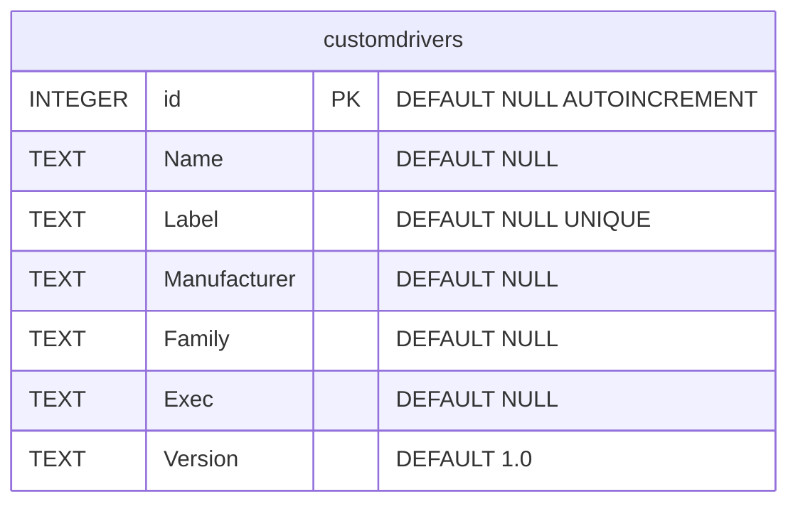
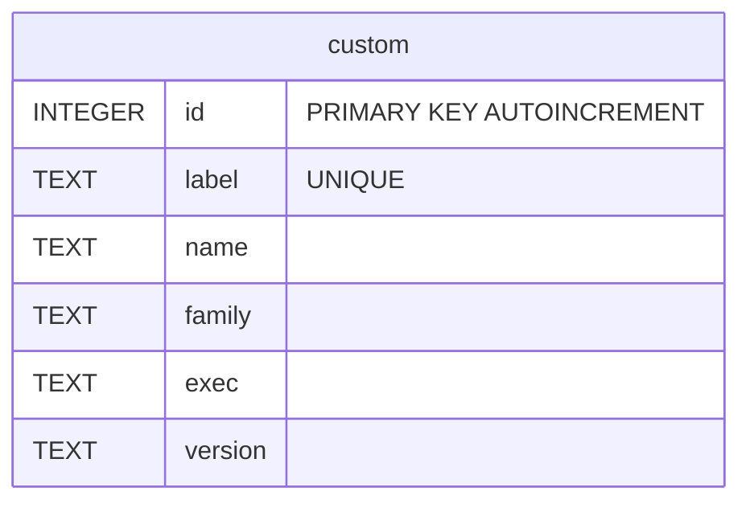

# Sync StellarMate Custom Drivers from Ekos to Web Manager

A Python script that synchronizes the custom driver information registered in Ekos with the custom driver definition in Web Manager.

## Specification

### Overview

- Synchronize the custom driver information registered in Ekos with the custom driver definition in Web Manager.
- If the destination table already contains the same data, handle it according to the command-line option.

### Caution

- All custom driver information already registered in the destination table will be deleted before synchronization.

### Processing

1. Open the source database in read-only mode. First read all data from the source table, then close the source database.
2. Back up the destination database. The backup file name is the destination database name with ".syncbackup" appended.
3. Before copying, display all rows from both the source table and the destination table. Show rows in ascending order by id.
4. Show a confirmation prompt before copying. The prompt should also warn that existing contents in the destination table will be deleted.
5. Delete all rows from the destination table.
6. Copy all rows from the source table into the destination table.
    - Copy rows in ascending order by source table id.
    - Copy the columns Name, Label, Family, Exec, and Version.
    - Display each row as it is copied.
7. After copying is complete, display all rows in the destination table.

### Command-line Options

#### --help

- Show usage information.
- Do not perform the copy.

#### --dryrun

- If specified, only print what would happen. Do not actually perform the copy.
- This option is off by default.

#### --force

- Perform the copy without showing the confirmation prompt.

## Source - Ekos User Definition

### Database File - userdb

`~/.var/app/org.kde.kstars/data/kstars/userdb.sqlite`

### Table Definition - userdb

## Destination - StellarMate Web Manager Definition

### Database File - profiles

`~/.indi/profiles.db`

### Table Definition - profiles

