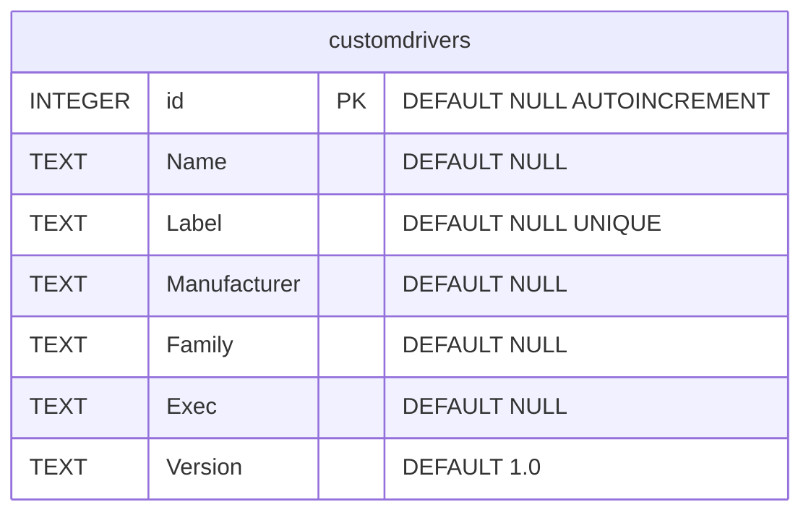
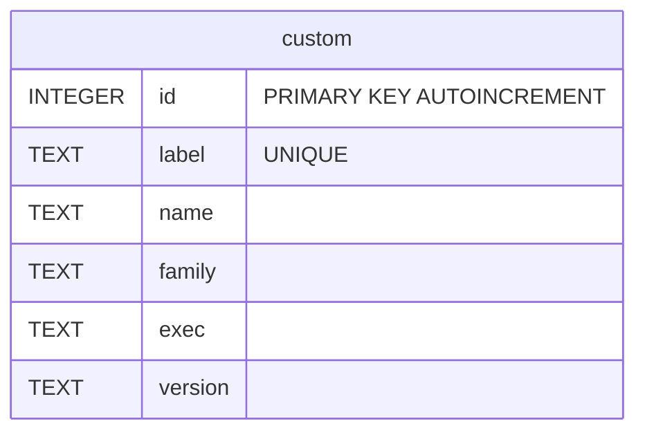

# Sync StellarMate Custom Drivers from Ekos to Web Manager

Ekosで登録したカスタムドライバーの情報をWeb Managerのカスタムドライバー定義へ同期するpythonスクリプト。

## 仕様

### 概要

- Ekosで登録したカスタムドライバーの情報をWeb Managerのカスタムドライバー定義へ同期する。

### 注意

- 転送先テーブルにもともと登録されているカスタムドライバーの情報は、同期前にすべて削除される。

### 処理

1. 転送元データベースは読み込み専用で開く。最初に転送元テーブルからすべてのデータを読み込み。以後転送元データベースを閉じる。
2. 転送先データベースはバックアップをとる。バックアップファイル名は 転送先データベース名 に ".syncbackup" を付与する。
3. コピー前に、転送元テーブルと転送先テーブルのすべての行を表示する。各テーブルの行の表示順はid列の昇順。
4. コピー前に実行確認のプロンプトを表示する。プロンプトには転送先テーブルの既存の内容が削除されることも表示する。
5. 転送先テーブルのすべての行を削除する。
6. 転送元テーブルのすべての行を転送先テーブルへコピーする。
    - コピー順は転送元テーブルの id の昇順。
    - 転送対象の列は Name, Label, Family, Exec, Version とする。
    - 一行コピーするたびにコピーした行を表示する。
7. コピー完了後に転送先テーブルのすべての行を表示する。

### コマンドラインオプション

#### --help

- 使い方の説明を表示する。
- 転送処理はしない。

#### --dryrun

- 指定された場合処理内容のメッセージを出力のみ行う。実際にはコピー処理を行わない。
- デフォルトは指定しない。

#### --force

- コピー前の実行確認のプロンプトを表示せず処理をコピー処理を実行する。

## 転送元 - Ekos のユーザー用定義

### データベースファイル - userdb

`~/.var/app/org.kde.kstars/data/kstars/userdb.sqlite`

### テーブル定義 - userdb

## 転送先 - StellarMate Web Manager用定義

### データベースファイル - profiles

`~/.indi/profiles.db`

### テーブル定義 - profiles

